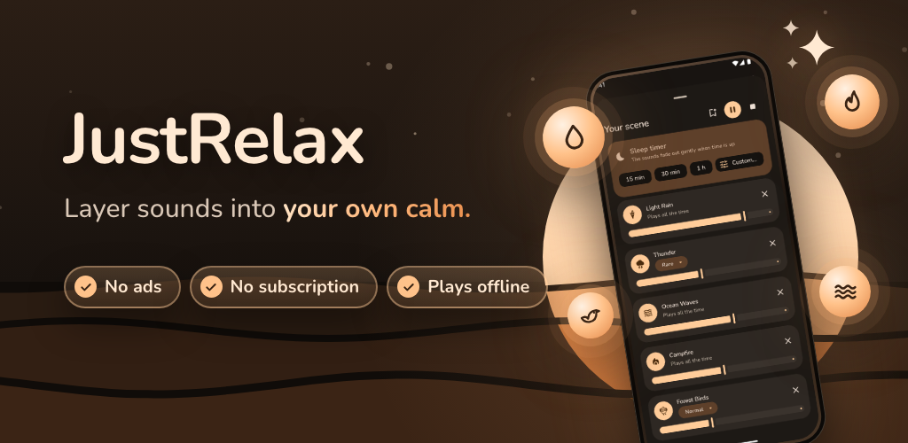
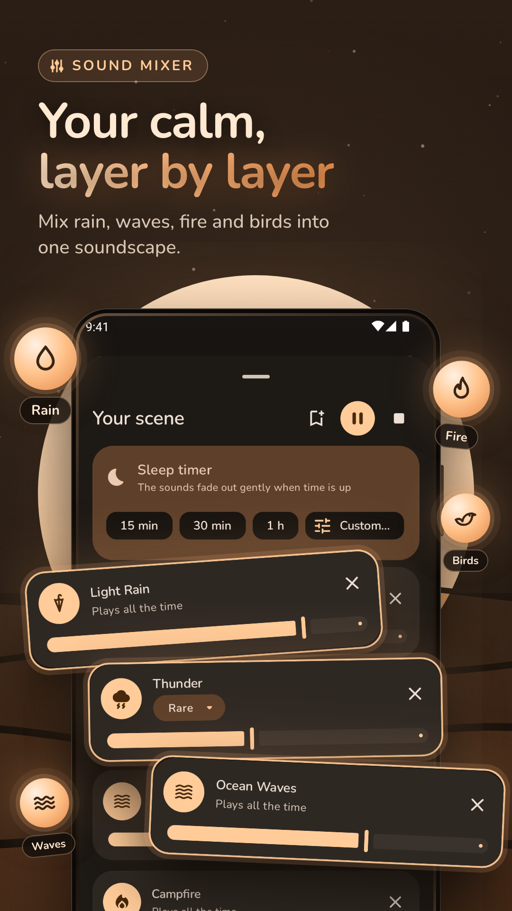
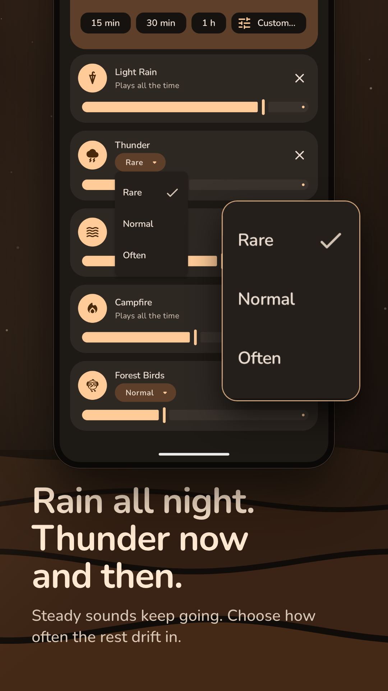
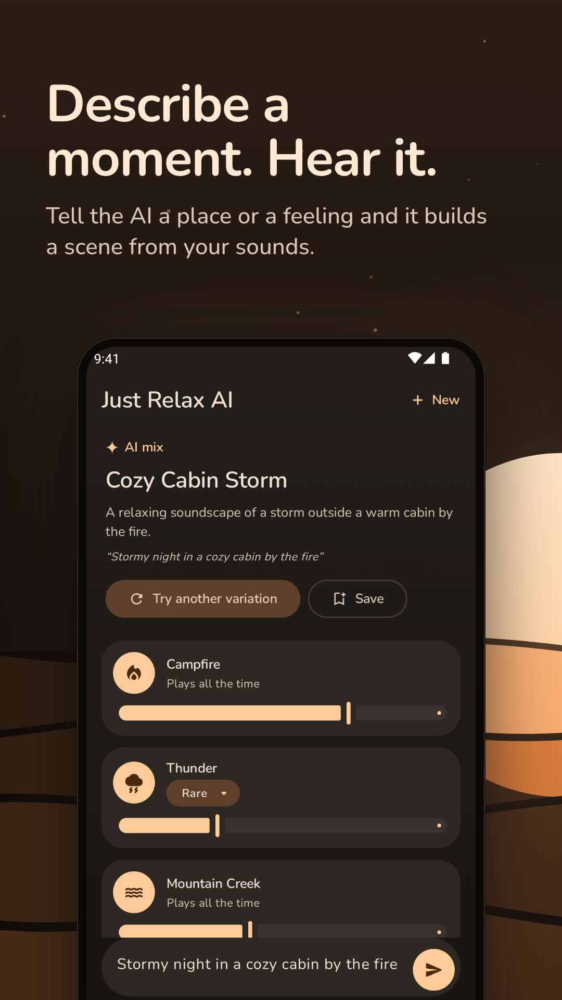
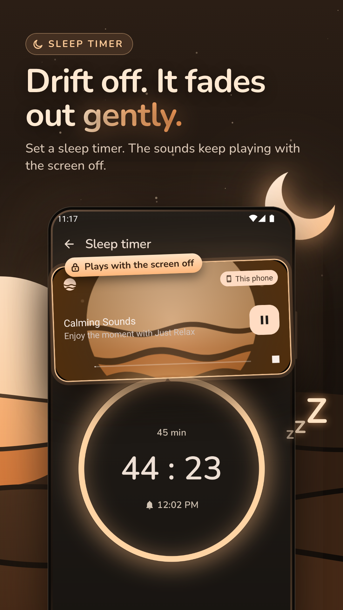
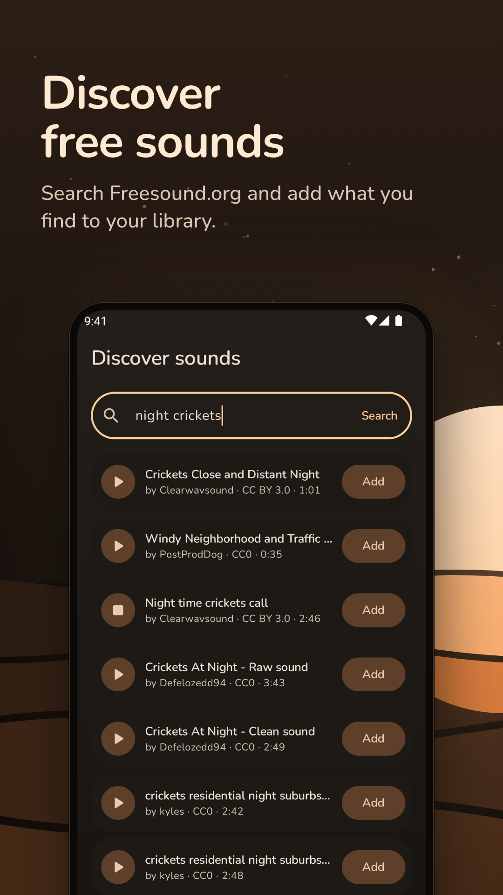
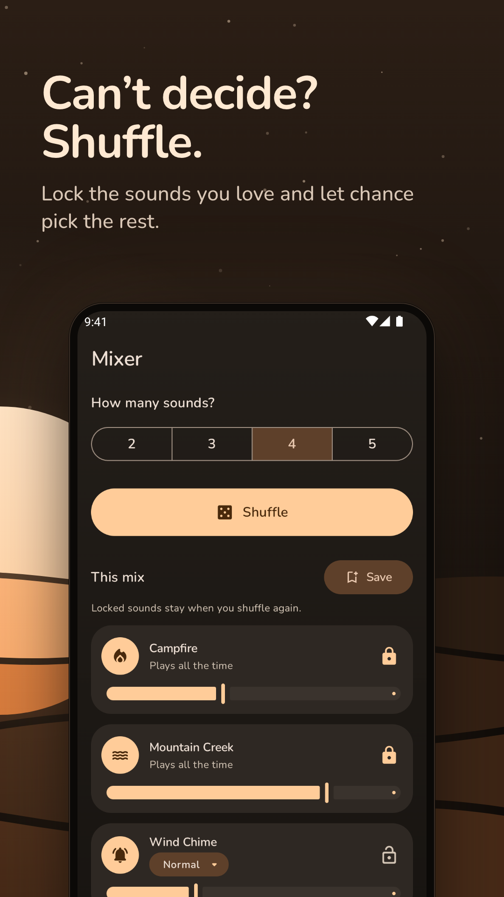
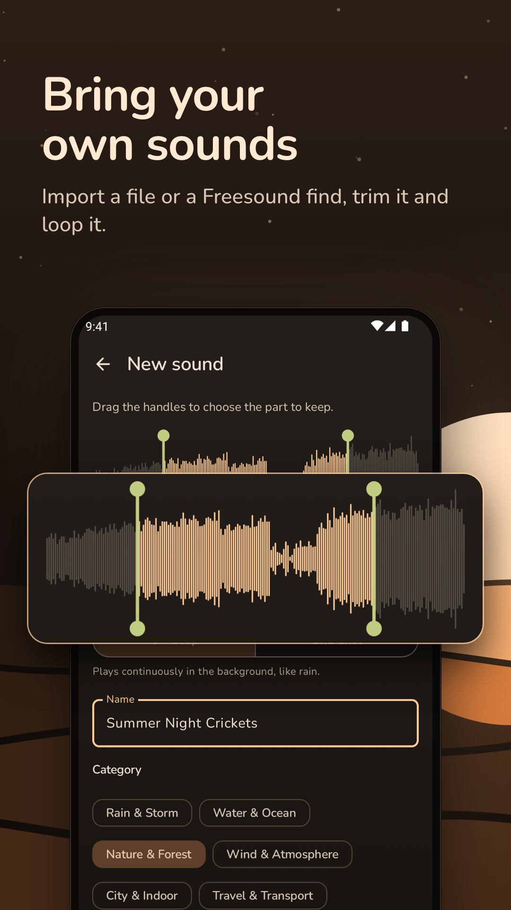
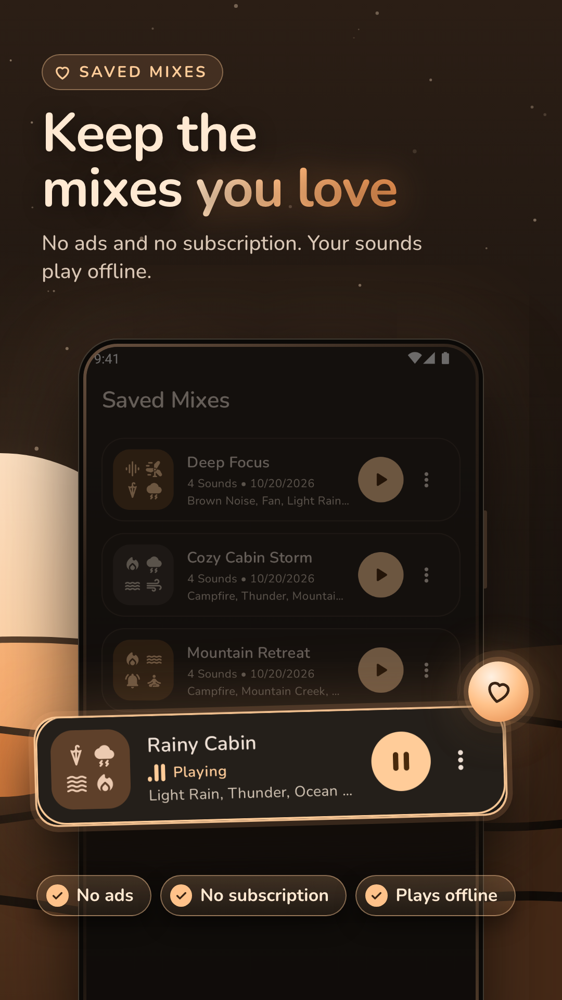
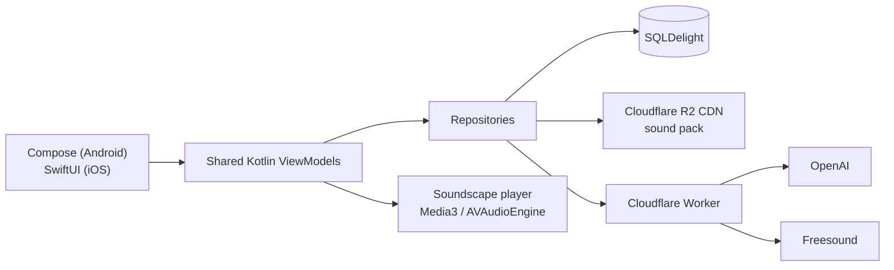

# JustRelax

A relaxing-sounds app where you layer rain, waves, fire and birds into one living scene, let AI build a scene from a sentence, and fall asleep to a timer that fades out gently.

[](https://play.google.com/store/apps/details?id=com.mustafakoceerr.justrelax)
[](https://github.com/MustafaKoceerr/JustRelax/actions/workflows/ci.yml)


## What it does

<table>
  <tr>
    <td></td>
    <td></td>
    <td></td>
    <td></td>
  </tr>
  <tr>
    <td></td>
    <td></td>
    <td></td>
    <td></td>
  </tr>
</table>

- **Scenes, not loops.** Steady sounds (rain, a fan) loop seamlessly. Others (thunder, an owl) drift in now and then, at a frequency you choose.
- **AI scenes.** Describe a place or a feeling, and a scene is built from the sounds you have.
- **Discover and import.** Search free sounds on Freesound.org, or import your own file, then trim it and loop it.
- **Sleep timer, saved mixes and a random mixer.** Playback continues in the background, with lock-screen controls.
- 12 languages, light and dark themes, phone and tablet layouts. No ads and no subscription.

## Why I built it

I started JustRelax in November 2025 as my first app on Google Play. Version 1 worked, but it was a plain sound player and it didn't stand out.

In October 2026 I rebuilt it from the ground up. I had two goals: make it something I want to fall asleep to, and use it to practise modern mobile development the way the platforms intend it:
- one real media player instead of workarounds;
- Google's architecture guidance;
- adaptive layouts;
- a shared Kotlin core with a native UI on each platform.

I measured instead of guessing, with Macrobenchmark and Perfetto traces on a real phone. I shipped it as 3.0.0.

## How it works



- **Kotlin Multiplatform, native UI.**
  - ViewModels, repositories and the audio engine's logic are shared Kotlin.
  - Android draws them with Jetpack Compose and iOS with SwiftUI; SKIE turns Flows into Swift async sequences.
- **One real player.**
  - On Android, the mixer is a single Media3 `Player` inside a `MediaSessionService`. Audio focus, headphone unplugging, background playback and system media controls all come from the platform.
  - On iOS, the same scene plays on one `AVAudioEngine`.
- **Offline-first data.**
  - The sound catalog is cached in SQLDelight and synced from a Cloudflare R2 CDN, so downloaded sounds play without a connection.
  - The architecture follows [Now in Android](https://github.com/android/nowinandroid): UI → data layers, with unidirectional `StateFlow` state.
- **No API keys in the app.**
  - AI and Freesound requests go through a Cloudflare Worker (TypeScript).
  - The Worker opens short sessions only for apps that pass Play Integrity (App Attest on iOS), and it rate-limits each install.
- **Assets from code.**
  - The icon family and these store graphics are generated by a TypeScript script and rendered with headless Chrome ([`tools/store-assets`](tools/store-assets/README.md)).
  - The sound pack is built by a Python pipeline ([`tools/sound-pipeline`](tools/sound-pipeline/README.md)).

## Tech stack

| Area | Technology |
|---|---|
| Language and build | Kotlin 2.4.20, Kotlin Multiplatform, Gradle convention plugins (`build-logic`), AGP 9 |
| Android UI | Jetpack Compose (BOM 2026.09.00), Material 3, Material 3 Adaptive, Navigation 3 |
| iOS UI | SwiftUI (iOS 27, Swift 6), SKIE |
| State and DI | ViewModel + `StateFlow`, Kotlin Coroutines, Koin |
| Data | SQLDelight, DataStore, Ktor, kotlinx.serialization, Okio |
| Audio | Media3 (ExoPlayer, MediaSession, Transformer), SoundPool, AVAudioEngine |
| Backend | Cloudflare Workers (TypeScript), Cloudflare R2, OpenAI API, Freesound API |
| Security | Play Integrity, App Attest; secrets only on the server |
| Observability | Firebase Analytics and Crashlytics, only after the user agrees |
| Performance | Macrobenchmark, Baseline Profiles, Perfetto |
| Tests and CI | kotlin.test, Turbine, Robolectric, Compose UI tests, Ktor MockEngine, Swift Testing, vitest, Python unittest, GitHub Actions |

## Quality

- **Tests:** 468 Kotlin unit tests, plus Swift, Worker (vitest) and sound-pipeline tests. All of them run in CI on every pull request, together with the iOS build and the database migration check.
- **Startup:** a Baseline Profile brought cold start from 764 ms to 571 ms on a Samsung Galaxy A52 ([results](docs/perf/results.md)).
- **Privacy:** no ads, no tracking, and analytics only with consent ([privacy policy and terms](docs/legal)).

## Build

```sh
./gradlew :androidApp:installDebug                  # run on a device or emulator
./gradlew testAndroidHostTest testDebugUnitTest     # Kotlin unit tests
./gradlew :core:database:verifySqlDelightMigration  # database migrations
```

- **iOS:** pass `-Pjustrelax.ios.enabled=true` (or set it in `gradle.properties`) and open `iosApp/` in Xcode 27.
- **Strings:** Android's `strings.xml` files are the source. Run `python3 tools/strings/strings.py xcstrings` to update the iOS String Catalog.
- **More docs:**
  - the API Worker: [`server/api-proxy`](server/api-proxy/README.md);
  - the sound pack: [`tools/sound-pipeline`](tools/sound-pipeline/README.md);
  - the store graphics: [`tools/store-assets`](tools/store-assets/README.md).

## License

[Apache License 2.0](LICENSE)
