# 🌿 Just Relax – Sound Mixing & Relaxation App

[](https://kotlinlang.org)
[](https://kotlinlang.org/docs/multiplatform.html)
[](https://developer.android.com/compose)
[](https://developer.android.com/topic/architecture)

> A **Kotlin Multiplatform** relaxation app: layer ambient sounds into a living soundscape, let AI suggest a mix, and fall asleep with a timer.

**▶️ Google Play:** https://play.google.com/store/apps/details?id=com.mustafakoceerr.justrelax

---

## ✨ Highlights

- 🎧 **Soundscapes, not loops:** each sound is either a seamless *bed* (rain, wind) or *events* (an owl, thunder) that play at random times, volumes and positions, at a frequency you choose.
- 🎚️ **Mixer:** a random mix of 2–5 sounds in one tap.
- 🧠 **AI mixes:** describe a mood and get a mix of the sounds you have.
- 📂 **My sounds:** import your own audio file, trim it and use it like any other sound.
- 🔎 **Freesound:** search and import CC0 / CC-BY sounds from [Freesound](https://freesound.org).
- ⏱️ **Sleep timer:** the sound fades out when it ends.
- 💾 **Saved mixes**, background playback with media controls, light and dark themes, 12 languages.
- ☕ **Tip jar** in Settings: consumable in-app purchases behind `TipRepository` (shown only while the store offers tips).

Screenshots below are from version 1.

📽️ Feature Demos
<details> <summary><b>🏠 Home & 🧠 AI Suggestions (Click to expand)</b></summary> <p align="center">  


<em>Explore ambient sounds and generate AI-driven mixes.</em> </p> </details>

<details> <summary><b>🎚️ Mixer & ⏱️ Timer (Click to expand)</b></summary> <p align="center">  


<em>Fine-tune your layers and set a sleep timer for your session.</em> </p> </details>

<details> <summary><b>💾 Saved Mixes & ⚙️ Settings (Click to expand)</b></summary> <p align="center">  


<em>Manage your favorite soundscapes and customize your app experience.</em> </p> </details>


## 🖼️ App Gallery

### 📱 Light Theme (8)

<table>
  <tr>
    <th>Splash</th>
    <th>Home</th>
    <th>AI</th>
    <th>AI (Alt)</th>
  </tr>
  <tr>
    <td></td>
    <td>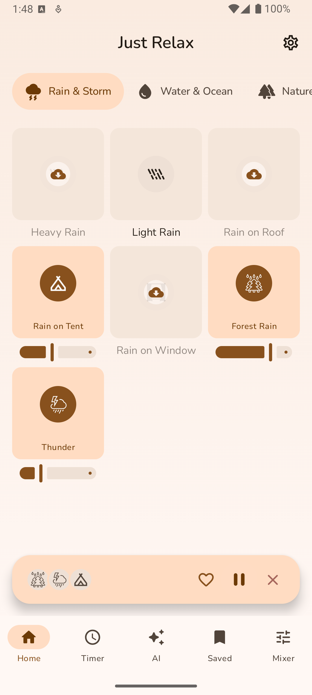</td>
    <td>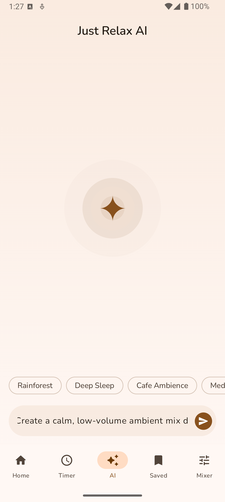</td>
    <td>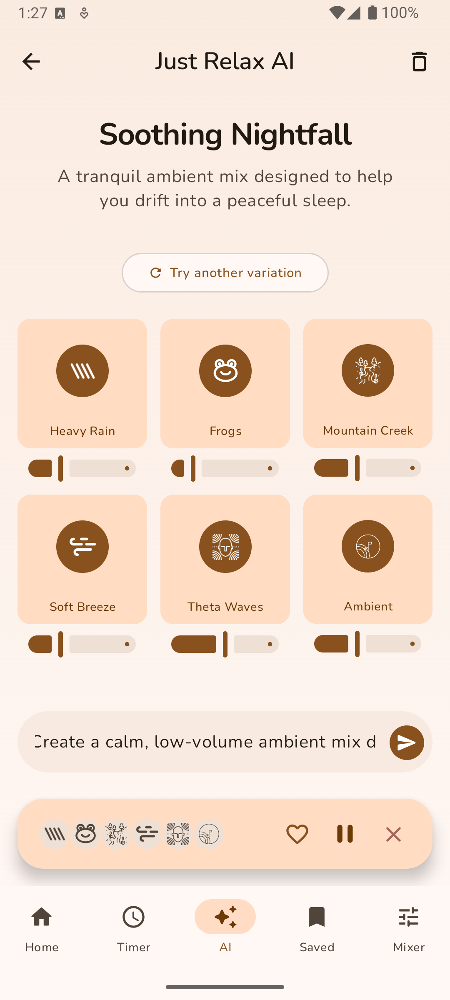</td>
  </tr>
</table>

<br/>

<table>
  <tr>
    <th>Mixer</th>
    <th>Timer</th>
    <th>Saved</th>
    <th>Settings</th>
  </tr>
  <tr>
    <td>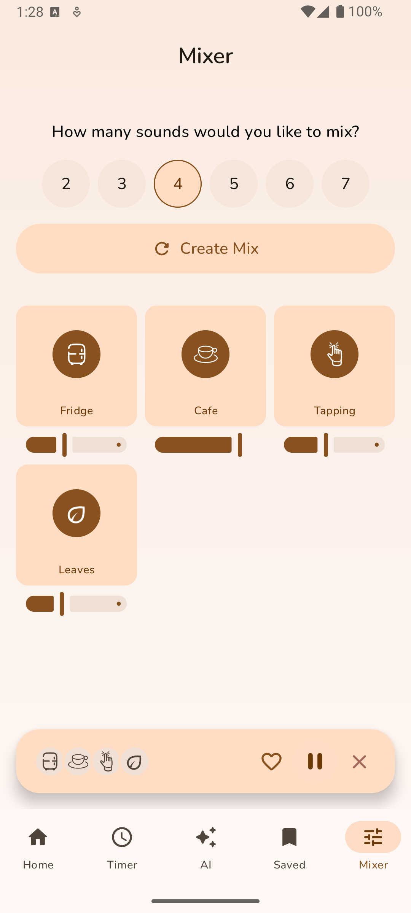</td>
    <td>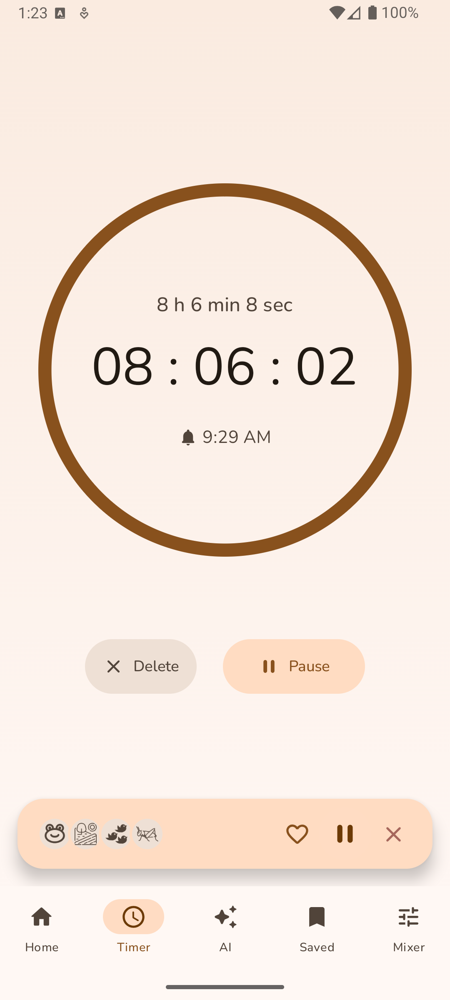</td>
    <td>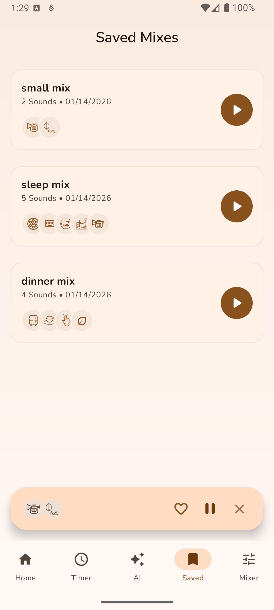</td>
    <td>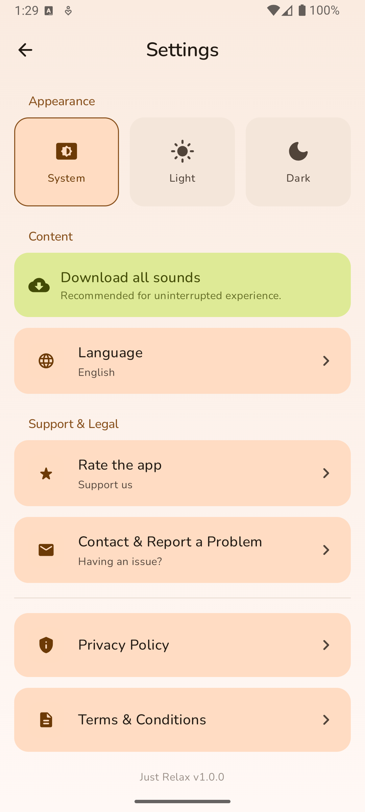</td>
  </tr>
</table>

---

### 🌙 Dark Theme (8)

<table>
  <tr>
    <th>Onboarding</th>
    <th>Home</th>
    <th>AI</th>
    <th>AI (Alt)</th>
  </tr>
  <tr>
    <td>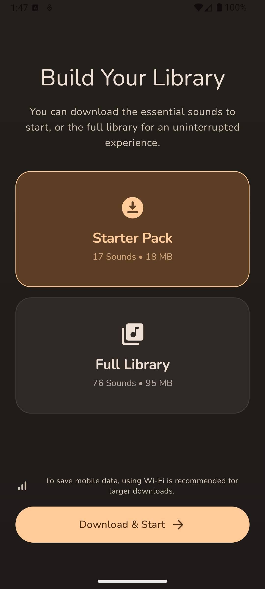</td>
    <td>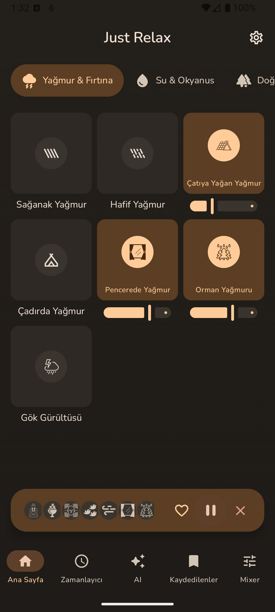</td>
    <td>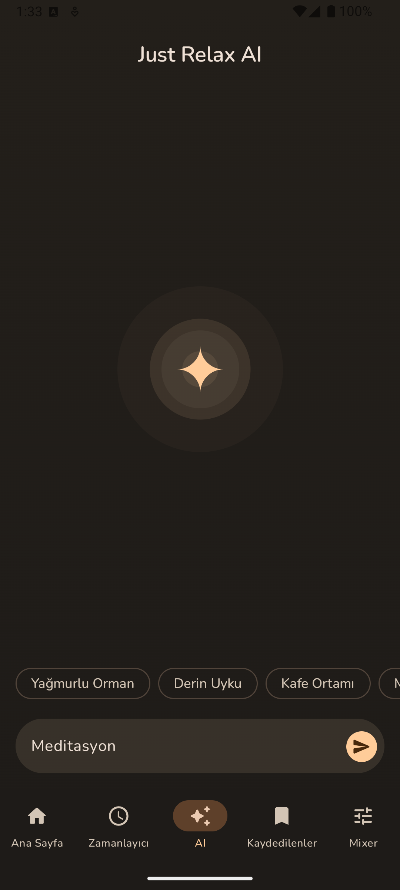</td>
    <td>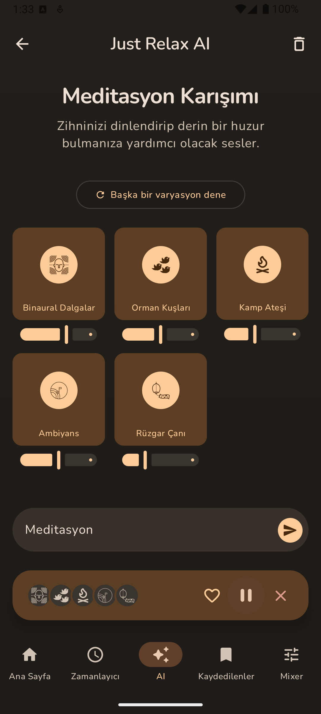</td>
  </tr>
</table>

<br/>

<table>
  <tr>
    <th>Mixer</th>
    <th>Timer</th>
    <th>Saved</th>
    <th>Settings</th>
  </tr>
  <tr>
    <td>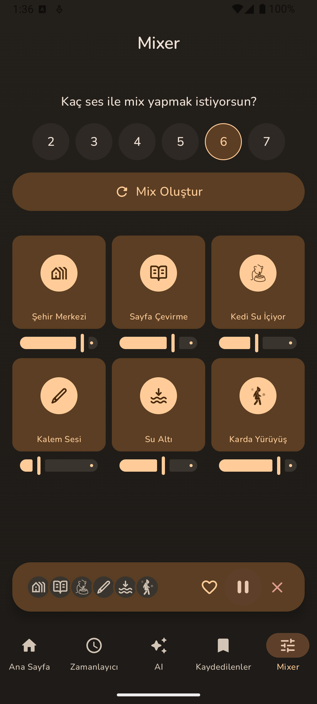</td>
    <td>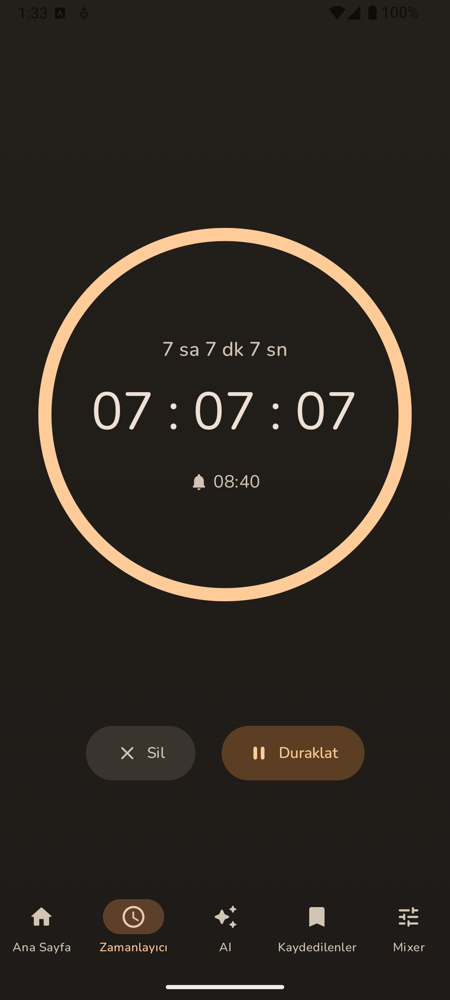</td>
    <td>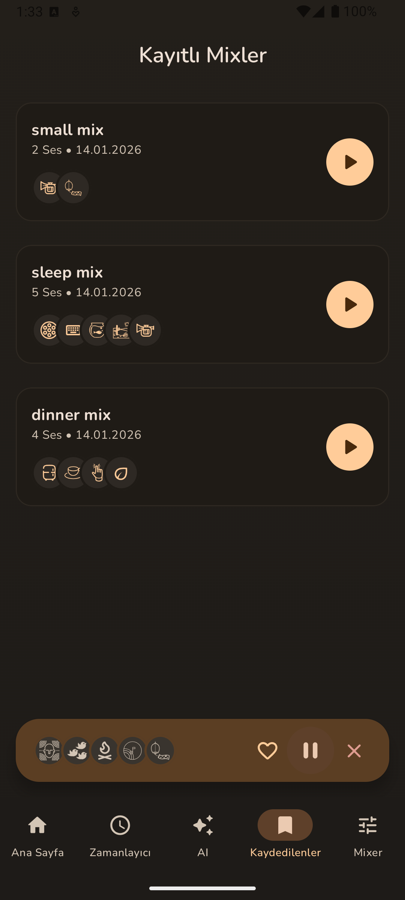</td>
    <td>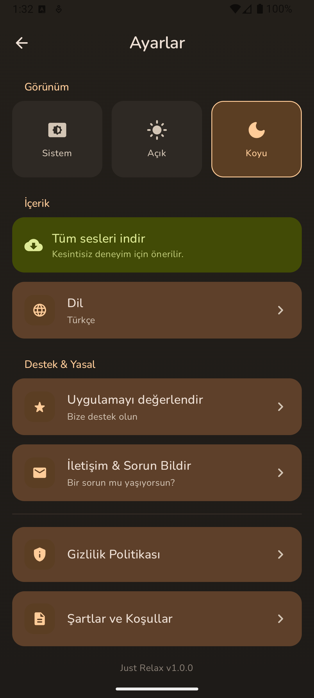</td>
  </tr>
</table>

---

## 🛠 Tech Stack

Versions come from [`gradle/libs.versions.toml`](gradle/libs.versions.toml).

| Area | Library |
|---|---|
| Language and build | Kotlin `2.4.20`, Android Gradle Plugin `9.4.1`, Gradle convention plugins in `build-logic` |
| Platforms | Android (min SDK 29, target 36, compile 37); iOS 26+ (off by default, not released yet: its SwiftUI screens are being written) |
| UI | Android: Jetpack Compose (BOM `2026.09.00`), Material 3, Material 3 Adaptive (bar, rail or drawer by window size). iOS: SwiftUI on the shared ViewModels, bridged with SKIE `0.10.15` |
| Navigation | Android: Navigation 3 `1.2.0` |
| State | ViewModel + `StateFlow`, Kotlin Coroutines `1.11.0` |
| DI | Koin `4.2.2` |
| Network | Ktor `3.6.0`, kotlinx.serialization `1.11.0` |
| Storage | SQLDelight `2.4.0`, DataStore `1.2.1`, Okio `3.18.2` |
| Audio | Android: Media3 `1.11.1` (ExoPlayer, MediaSession, Transformer for trimming). iOS: AVAudioEngine, AVAudioSession, MediaPlayer |
| Analytics | Firebase Analytics and Crashlytics, only after the user agrees |
| Backend | Cloudflare Workers (API proxy) and R2 (sound CDN), free plan |
| Tests | kotlin.test, Turbine, Robolectric, Ktor MockEngine, vitest, Python unittest |

---

## 🧩 Architecture

The app follows Google's [app architecture guide](https://developer.android.com/topic/architecture) and the layout of [Now in Android](https://github.com/android/nowinandroid):

- **UI layer:** a screen observes one `UiState` from its ViewModel and sends it events (MVVM). The ViewModels and their state are shared Kotlin code; Android draws them with Compose and iOS with SwiftUI. A ViewModel reports one-off messages as its own type (for example `AiMessage.Offline`), and each platform picks the words.
- **Data layer:** repositories are the single source of truth. The sound catalog is offline-first: it is cached in SQLDelight and refreshed from the CDN once a day.
- **Playback:** one `SoundscapePlayer` (a Media3 `Player`) runs in a `MediaSessionService`. It mixes beds and schedules events, so playback keeps going in the background and shows in the system media controls. On iOS the same session runs in-process on one `AVAudioEngine` (`AvAudioGraph`); `IosAudioSession` follows iOS's default interruption and route-change behaviour and drives the lock screen controls. AVFoundation reads the pack's Ogg Opus clips from iOS 18.4; the app needs iOS 26 for its SwiftUI design.
- **API keys never ship in the app.** AI and Freesound calls go through a Cloudflare Worker. The Worker checks Play Integrity, issues a short session and rate-limits each install.

```text
.
├── androidApp/          Android application: activity, PlaybackService, Firebase
├── shared/              Koin graph and app-wide state; the iOS "Shared" framework
├── iosApp/              Xcode project
├── core/
│   ├── common/          Result types, errors, dispatchers
│   ├── model/           Domain models
│   ├── database/        SQLDelight schema and migrations
│   ├── network/         Ktor clients for the CDN and the API proxy
│   ├── data/            Repositories, catalog sync, downloads, DataStore
│   ├── media/           Audio import, trimming and preview
│   ├── playback/        Soundscape engine, MediaSession player, sleep timer
│   ├── analytics/       Analytics and crash-reporting interfaces
│   ├── presentation/    UI models, formatters, test tags and system actions for both UIs
│   ├── ui/              Android design system: theme, Compose components and strings
│   └── testing/         Fakes and test helpers
├── feature/             library, scene, mixer, ai, timer, saved, mysounds, freesound, settings, splash:
│                        each x/ has the shared ViewModels, x/ui/ the Android Compose screens
├── build-logic/         Convention plugins (KMP library and feature, Android library, Compose and feature UI, Koin, Android app)
├── server/api-proxy/    Cloudflare Worker for AI, Freesound and sessions
├── tools/sound-pipeline/ Builds the sound pack (sounds-v2.json + Opus clips)
├── tools/strings/       Writes the iOS String Catalog from the Android strings
└── docs/                Play data safety notes and the owner's to-do list
```

Each feature module depends only on `core` modules, never on another feature; `:feature:x:ui` also depends on its own `:feature:x`.

---

## ▶️ Building and testing

```sh
./gradlew :androidApp:installDebug                            # run on a device or emulator
./gradlew testAndroidHostTest testDebugUnitTest               # all Kotlin unit tests
./gradlew :core:database:verifySqlDelightMigration            # database migrations
```

- **Firebase:** Analytics and Crashlytics are added only when `androidApp/google-services.json` exists. Without it the app builds and runs normally.
- **iOS:** set `justrelax.ios.enabled=true` in `gradle.properties` (or pass `-Pjustrelax.ios.enabled=true`) and open `iosApp/` in Xcode. Kotlin iOS tests run on the simulator with `./gradlew iosSimulatorArm64Test -Pjustrelax.ios.enabled=true`, Swift tests with `xcodebuild test -project iosApp/iosApp.xcodeproj -scheme iosApp -destination 'platform=iOS Simulator,name=iPhone 18 Pro' -only-testing:iosAppTests` (Xcode must be the selected developer directory, not only the command line tools). A SwiftUI screen keeps its shared ViewModels in a `ViewModelHost` and follows their `StateFlow`s with `for await`.
- **Strings:** Android's `res/values*/strings.xml` are the source. After changing them, run `python3 tools/strings/strings.py xcstrings` to update iOS's `Localizable.xcstrings`; CI fails if it is out of date.
- **API proxy:** see [`server/api-proxy/README.md`](server/api-proxy/README.md) (`npm test`, `npm run deploy`).
- **Sound pack:** see [`tools/sound-pipeline/README.md`](tools/sound-pipeline/README.md) (`python3 -m unittest discover -s tools/sound-pipeline`).

CI runs all of the above on every pull request.

---

## 📄 License

Licensed under the **Apache License, Version 2.0**. See the [LICENSE](LICENSE) file for details.

## 🔔 Notice

See the [NOTICE](NOTICE) file for attribution and additional information.
